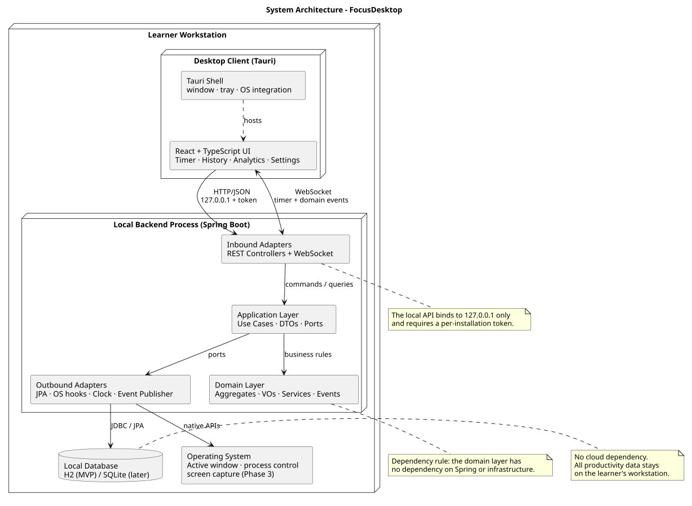

# System Architecture

FocusDesktop is a local-first desktop application. A small React/Tauri client
runs on the learner's workstation and talks to a local Spring Boot process over
loopback. The backend owns the timer, session lifecycle, blocking policy and
read-model projections; no productivity data leaves the machine.



The PlantUML source is [`SystemArchitecture.puml`](SystemArchitecture.puml).

## 1. Architectural goals

| Goal | Consequence |
|---|---|
| Local-first privacy | No cloud dependency, no telemetry, no outbound calls in the core runtime. |
| Correct timer behaviour | The backend is authoritative; the UI never computes elapsed time. |
| Recover after restart | An active session is reloaded from the database with its remaining time. |
| Rebuildable analytics | Progress and analytics are read models fed by domain events. |
| Replaceable desktop shell | The UI talks to the local HTTP/WebSocket API, not to Java internals. |
| Testable domain | The domain layer has no Spring or JPA dependency. |

## 2. Containers and responsibilities

| Container | Technology | Responsibility |
|---|---|---|
| Desktop client | React + TypeScript, hosted by Tauri | Timer, history, analytics, settings and distraction-review screens. |
| Local backend | Spring Boot (Java) | REST API, WebSocket updates, use cases, domain model and persistence. |
| Local database | H2 for the MVP; SQLite is a later option | Sessions, intervals, settings, blocking policies and projections. |
| Operating-system adapter | Native Tauri/Java hooks | Active-window detection, process blocking and Phase 3 screen capture. |

The client and backend run as one desktop installation. The backend binds to
`127.0.0.1` and requires a per-installation token. The token is generated at
startup and handed to the client through the Tauri shell.

## 3. Layering

The backend follows the dependency rule:

```text
Infrastructure → Application → Domain
```

- **Domain** contains aggregates, entities, value objects, domain services and
  domain events. It has no Spring, JPA or HTTP types.
- **Application** contains use cases, commands/queries, DTOs and outbound ports.
  It orchestrates transactions and appends domain events to the outbox in the
  same transaction.
- **Infrastructure** contains REST controllers, WebSocket handlers, JPA
  adapters, OS adapters, the clock, the outbox dispatcher and projections.
- **Read models** are projections in `Progress & Analytics`. They are not
  domain aggregates and are never loaded by write-side use cases.

The domain concepts are described in the [domain model](../DM/DomainModel.md);
runtime interactions and persistence are described in the sequence diagrams and
[persistence documentation](../data/Persistence.md).

## 4. Runtime flows

### 4.1 Session lifecycle

1. The UI sends `POST /api/v1/sessions`.
2. `StartSessionUseCase` loads `AppSettings`, maps `TimerPreferences` to a
   `SessionSettings` snapshot, creates `FocusSession` through
   `FocusSessionFactory` and saves it.
3. The session and `SessionStarted` outbox record commit atomically; the
   dispatcher forwards the event to projections and WebSocket after commit.
4. The backend scheduler invokes interval completion internally. The
   `SessionIntervalScheduleService` selects the next interval type; the
   aggregate applies the transition. The client explicitly starts a pending
   interval through REST when auto-start is disabled. Other changes follow the
   command → aggregate → outbox → projection/WebSocket path.

The timer is server-authoritative. The client renders the remaining time from
the latest snapshot and counts locally between snapshots. It polls the active
session every 30 seconds while running and reconciles immediately after a
state-changing response/event or WebSocket reconnection. WebSocket snapshots
are emitted on state and interval changes, not once per second.

### 4.2 Analytics projection

```text
SessionCompleted ─┐
DistractionDetected ─┼─▶ DailyProgressProjection ─▶ DailyProgress read model
DistractionBlocked ─┤
DistractionBlockFailed ─┘
                         │
                         └─▶ DistractionLogProjection ─▶ DistractionLog read model

DailyProgress + SessionSummaries ─▶ AnalyticsSummaryAssembler ─▶ ProductivitySummary
```

Projections are idempotent. Replaying an event must not duplicate read-model
rows. `AnalyticsSummaryAssembler` builds `ProductivitySummary` per query; it does
not mutate domain state.

### 4.3 Distraction control

The monitoring loop runs only while a session is `RUNNING`:

1. `ActiveWindowPort` reads the current window.
2. `DistractionPolicyService` evaluates the active `BlockingPolicy`.
3. A matched rule produces a `BlockingDecision`.
4. `DistractionDetected` is published; the read-model projections update the
   log and daily progress.
5. If the action is `BLOCK`, `BlockDistractionUseCase` calls the platform
   blocker port and publishes `DistractionBlocked` or
   `DistractionBlockFailed`.

The write side never updates the `DistractionLog` directly.

## 5. API and event transport

- REST is the command/query transport (`/api/v1/...`).
- WebSocket is used for live timer state and domain-event notifications.
- The API contract, error codes and event payloads are documented in
  [`../api/RESTAndWebSocket.md`](../api/RESTAndWebSocket.md).

## 6. Persistence and projections

The write model and read model share one local database but use separate tables.
The write side includes `focus_session`, `session_interval`, `blocking_policy`,
`blocking_rule`, `app_settings` and the durable outbox. `daily_progress` and
`distraction_log` are read-model tables. `ProductivitySummary` is computed on
read and is not stored as a table. See
[`../data/Persistence.md`](../data/Persistence.md).

## 7. Security and privacy

- Loopback binding only; non-loopback origins are rejected.
- Per-installation bearer token for every API request.
- No analytics SDK, telemetry or crash uploader.
- Privacy tests block non-loopback sockets.
- Retention cleanup runs on startup and daily; it never deletes the active
  session.
- "Delete all data" requires explicit confirmation and recreates defaults.

## 8. Failure and recovery

| Failure | Behaviour |
|---|---|
| Backend crashes during a session | On restart, the active session is reloaded from the database with its remaining time. |
| WebSocket disconnects | The client reconnects and requests the current timer snapshot. |
| OS denies active-window access | Monitoring is disabled for the session with a capability warning; the timer keeps working. |
| Blocking adapter fails | `DistractionBlockFailed` is published; the learner is warned; the backend stays healthy. |
| Projection misses an event | Retry the durable outbox record or rebuild the projection from retained sessions and outbox events. |

## 9. Deployment

The MVP ships as a Tauri desktop bundle with a bundled JRE and the Spring Boot
application. The backend starts with the desktop shell and uses an embedded H2
database in the user's application-data directory. A CI matrix builds on
Windows, macOS and Linux; installer smoke tests verify the bundle starts
offline.

## 10. Related documents

- [Requirements](../requirements/FunctionalRequirements.md)
- [Domain model](../DM/DomainModel.md)
- [Sequence diagrams](../SD/SequenceDiagrams.md)
- [Persistence](../data/Persistence.md)
- [ADR-001 Local-first](../decisions/ADR-001-LocalFirst.md)
- [ADR-002 Spring Boot sidecar](../decisions/ADR-002-SpringBootSidecar.md)
- [ADR-003 Tauri vs Electron](../decisions/ADR-003-TauriVsElectron.md)
- [ADR-004 DDD layering](../decisions/ADR-004-DDD-Layering.md)
- [ADR-005 H2 vs SQLite](../decisions/ADR-005-H2VsSQLite.md)
